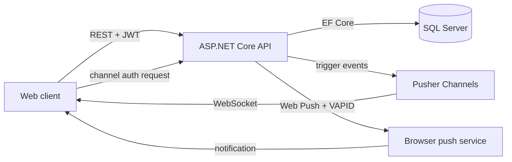

# RealTimeChat: Real-Time Messaging & Push Notification API


-5A0FC8?style=flat-square)

-lightgrey?style=flat-square)

A REST API for a real-time chat application. It supports **one-to-one and group messaging** over **Pusher Channels**, **presence** (who is online), **delivery receipts**, and **browser push notifications** using the **Web Push protocol with VAPID keys**. Users register and sign in through **ASP.NET Core Identity** and receive a **JWT** for all protected calls.


> **Note:** Built in 2020 on ASP.NET Core 2.2 and kept as a portfolio project. It is not actively maintained. For my current work, see [OrderPoint](https://github.com/siqbalk/OrderPoint) and [MicroMart](https://github.com/siqbalk/MicroMart).

---

## Features

- **Registration and login** with ASP.NET Core Identity, issuing signed JWTs with a claims-based `ApiUser` policy
- **One-to-one chat.** Messages are stored in SQL Server and broadcast instantly to the recipient's Pusher channel
- **Group chat.** Create groups, add members, and broadcast group messages
- **Private and presence channels.** The API authenticates Pusher channel subscriptions, so users can only join their own private channels, and presence channels carry user info for online status
- **Delivery receipts.** Clients confirm delivery and the sender is notified in real time
- **Web Push notifications.** Browsers subscribe with their push endpoint, subscriptions are stored per user, and the server sends notifications signed with VAPID keys, with optional delayed delivery
- **Validation and mapping** with FluentValidation and AutoMapper

---

## Architecture



The API is the only component that holds the Pusher secret. Clients connect to Pusher with the public key, and every private or presence subscription is authorized through `POST /api/auth/AuthForChannel/{channel}/{socketId}`.

---

## API endpoints

| Area | Method | Route | Purpose |
|---|---|---|---|
| Account | POST | `/api/account` | Register a new user |
| Auth | POST | `/api/auth/login` | Sign in and receive a JWT |
| Auth | POST | `/api/auth/AuthForChannel/{channel_name}/{socket_id}` | Authorize a Pusher private/presence channel |
| Chat | GET | `/api/chat/allUsers` | List users to chat with |
| Chat | GET | `/api/chat/CurrentUser` | Current user's profile |
| Chat | GET | `/api/chat/ConversationWithContact/{contact}` | Message history with a contact |
| Chat | POST | `/api/chat/SendMessage` | Send a direct message |
| Chat | POST | `/api/chat/MessageDelivered/{message_id}` | Mark a message delivered |
| Groups | GET | `/api/group/GetAll` | List groups |
| Groups | POST | `/api/group/Create` | Create a group |
| Group messages | GET | `/api/groupmessage/GetById/{group_id}` | Group message history |
| Group messages | POST | `/api/groupmessage/GroupMessageSend` | Send a group message |
| Push | GET | `/api/pushnotification/vapidpublickey` | Public VAPID key for the browser |
| Push | POST | `/api/pushnotification/subscribe` | Save a push subscription |
| Push | POST | `/api/pushnotification/unsubscribe` | Remove a push subscription |
| Push | POST | `/api/pushnotification/send/{userId}?delay=` | Send a notification to a user |

---

## Data model

`AppUser` (Identity user) · `Conversation` (direct messages) · `Group` · `UserGroup` (membership) · `GroupMessage` · `PushSubscription`

---

## Tech stack

| Area | Technology |
|---|---|
| Framework | ASP.NET Core 2.2 Web API |
| Data | Entity Framework Core, SQL Server |
| Identity | ASP.NET Core Identity, JWT bearer tokens |
| Real-time | Pusher Channels (`PusherServer`) |
| Notifications | Web Push protocol with VAPID (`WebPush`) |
| Other | AutoMapper, FluentValidation |

---

## Getting started

### Prerequisites

- [.NET Core 2.2 SDK](https://dotnet.microsoft.com/download/dotnet/2.2) (end of life; see Modernization below)
- SQL Server or SQL Server Express
- A free [Pusher Channels](https://pusher.com/channels) app (cluster `ap2`)

### Configuration

Keep secrets out of source control with user-secrets:

```bash
cd OnlineChat
dotnet user-secrets init
dotnet user-secrets set "ConnectionStrings:OnlineChatConnectionString" "Server=.\\SQLEXPRESS;Database=OnlineChatDb;Trusted_Connection=True;"
dotnet user-secrets set "Secret:APIKey" "<a long random signing key>"
dotnet user-secrets set "PUSHER_APP_ID" "<pusher app id>"
dotnet user-secrets set "PUSHER_APP_KEY" "<pusher key>"
dotnet user-secrets set "PUSHER_APP_SECRET" "<pusher secret>"
dotnet user-secrets set "Vapidsubject" "mailto:you@example.com"
dotnet user-secrets set "VapidpublicKey" "<vapid public key>"
dotnet user-secrets set "VapidprivateKey" "<vapid private key>"
```

You can generate a VAPID key pair with `npx web-push generate-vapid-keys`.

### Run

```bash
dotnet ef database update
dotnet run
```

---

## Modernization

If I rebuilt this today, I would:

- Upgrade to .NET 10 with minimal APIs
- Replace Pusher with **ASP.NET Core SignalR** (or Azure SignalR Service) to remove the third-party dependency
- Move the Pusher client setup out of each controller into a single injected service
- Send push notifications from a background worker with retries instead of inside the request

---

## Author

**Syed Iqbal** · Senior .NET Developer
[LinkedIn](https://www.linkedin.com/in/syed--iqbal/) · [GitHub](https://github.com/siqbalk)
